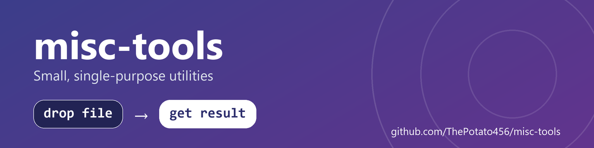

<div align="center">



# misc-tools

**Small, single-purpose utilities. One job each, no setup: drop files on the exe, or run it from the command line.**

[](#tools)
[](https://www.python.org/)
[](#tools)
[](https://github.com/ThePotato456/misc-tools/releases)
[](https://github.com/ThePotato456/misc-tools/commits/main)

</div>

## Tools

| Tool | What it does | Needs | Download |
| --- | --- | --- | --- |
| 🎬 [**vid2cord**](vid2cord-py/README.md) | Shrinks a video to fit Discord's upload limit | ffmpeg | [](https://github.com/ThePotato456/misc-tools/releases?q=vid2cord-py&expanded=true) |
| 🖼️ [**webp2png**](webp2png-py/README.md) | Converts WebP images to PNG | none | [](https://github.com/ThePotato456/misc-tools/releases?q=webp2png-py&expanded=true) |
| 📷 [**png2jpg**](png2jpg-py/README.md) | Converts PNG images to JPG | none | [](https://github.com/ThePotato456/misc-tools/releases?q=png2jpg-py&expanded=true) |

Every tool works the same way:

- **Drag and drop** files or folders onto the `.exe`. Output lands next to the originals, and the window stays open so you can read the results.
- **Command line**: pass files and/or folders. `-r` recurses, `-o DIR` picks an output folder, `-f` overwrites, `-V` prints the version.
- Existing outputs are skipped unless you pass `-f`.

---

### 🎬 vid2cord

[](https://ffmpeg.org/download.html)
[](#-vid2cord)

Re-encodes any video so it fits under Discord's upload size limit, while keeping as much quality as the size allows.

- Targets **20 MB** by default; pick any limit with `-s MB`.
- Two-pass H.264 + AAC at the highest bitrate that fits, and retries smaller if the result runs over.
- Lowers the resolution only when the bitrate is too low for a clean picture.
- Skips files that already fit. Output: `<name>_discord.mp4`.

```
vid2cord video.mp4
vid2cord video.mp4 -s 10      # 10 MB limit
vid2cord clips -r             # every video under a folder
```

Reads `.mp4 .mov .mkv .webm .avi .m4v .flv .wmv .ts`. [Full docs →](vid2cord-py/README.md)

---

### 🖼️ webp2png

[](https://python-pillow.org/)

Converts WebP images to PNG, keeping transparency.

- Files, folders, or drag and drop.
- Animated WebP files keep their first frame.

```
webp2png image.webp
webp2png downloads -r -o png  # a whole folder tree into ./png
```

[Full docs →](webp2png-py/README.md)

---

### 📷 png2jpg

[](https://python-pillow.org/)

Converts PNG images to JPG. JPEG has no transparency, so transparent areas are filled with a background color you choose.

- Quality with `-q 1-95` (default 92).
- Background for transparent areas with `-b RRGGBB` (default white).
- Animated PNGs keep their first frame.

```
png2jpg image.png
png2jpg image.png -q 80 -b 000000   # smaller file, black background
png2jpg screenshots -r
```

[Full docs →](png2jpg-py/README.md)

---

## Build from source

Each tool folder builds on its own. You need Python 3.10+ and `make`.

```
cd <tool>
make exe          # installs dependencies, builds dist/<tool>.exe
```

Or run the script directly: `pip install -r requirements.txt`, then `python <tool>.py --help`.

<div align="center">

Made by **ThePotato456**

</div>
