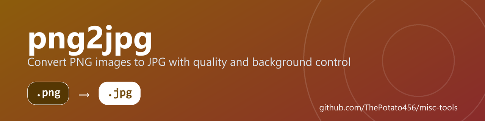

<div align="center">



# 📷 png2jpg

**Convert PNG images to JPG. Single files, folders, or drag and drop.**

[](CHANGELOG.md)
[](https://github.com/ThePotato456/misc-tools/releases?q=png2jpg-py&expanded=true)
[](#install)
[](https://www.python.org/)
[](https://python-pillow.org/)

</div>

## Features

- Whole folders, recursively, with an optional output folder.
- Adjustable JPEG quality.
- Transparent areas filled with a background color of your choice.
- Skips files that are already converted.

## Use

- **Drag and drop**: drop .png files and/or folders onto `png2jpg.exe`. Output lands next to the originals, and the window stays open so you can read the results.
- **Command line**: pass files and/or folders.

```
png2jpg image.png
png2jpg folder -r             # recurse
png2jpg a.png b.png -o out    # output folder
png2jpg image.png -q 85       # JPEG quality, 1-95 (default 92)
png2jpg image.png -b 000000   # black background for transparent areas
png2jpg image.png -f          # overwrite existing JPGs
```

Existing JPGs are skipped unless `-f` is given. JPEG has no transparency, so transparent areas are filled with the background color. Animated PNGs keep their first frame only.

## Options

| Flag | Meaning |
| --- | --- |
| `-q`, `--quality N` | JPEG quality, 1-95 (default 92) |
| `-b`, `--background RRGGBB` | Fill for transparent areas (default `ffffff`, white) |
| `-r`, `--recursive` | Search folders recursively |
| `-o`, `--out DIR` | Output folder (default: next to each source) |
| `-f`, `--force` | Overwrite existing outputs |
| `-V`, `--version` | Print the version |
| `-h`, `--help` | Show help |

## Install

Download `png2jpg.exe` from the [latest release](https://github.com/ThePotato456/misc-tools/releases?q=png2jpg-py&expanded=true). No installer and no Python needed.

## Build from source

You need Python 3.10+ and `make`.

```
make exe                       # installs dependencies, builds dist/png2jpg.exe
```

Or run the script directly:

```
pip install -r requirements.txt
python png2jpg.py --help
```

## Links

- [Changelog](CHANGELOG.md)
- [All png2jpg releases](https://github.com/ThePotato456/misc-tools/releases?q=png2jpg-py&expanded=true)
- [Other tools in misc-tools](https://github.com/ThePotato456/misc-tools)

---

<div align="center">

Made by **ThePotato456**

</div>
