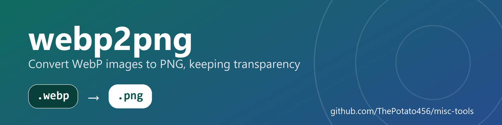

<div align="center">



# 🖼️ webp2png

**Convert WebP images to PNG. Single files, folders, or drag and drop.**

[](CHANGELOG.md)
[](https://github.com/ThePotato456/misc-tools/releases?q=webp2png-py&expanded=true)
[](#install)
[](https://www.python.org/)
[](https://python-pillow.org/)

</div>

## Features

- Whole folders, recursively, with an optional output folder.
- Keeps transparency.
- Skips files that are already converted.

## Use

- **Drag and drop**: drop .webp files and/or folders onto `webp2png.exe`. Output lands next to the originals, and the window stays open so you can read the results.
- **Command line**: pass files and/or folders.

```
webp2png image.webp
webp2png folder -r             # recurse
webp2png a.webp b.webp -o out # output folder
webp2png image.webp -f        # overwrite existing PNGs
```

Existing PNGs are skipped unless `-f` is given. Animated WebP files keep their first frame only.

## Options

| Flag | Meaning |
| --- | --- |
| `-r`, `--recursive` | Search folders recursively |
| `-o`, `--out DIR` | Output folder (default: next to each source) |
| `-f`, `--force` | Overwrite existing outputs |
| `-V`, `--version` | Print the version |
| `-h`, `--help` | Show help |

## Install

Download `webp2png.exe` from the [latest release](https://github.com/ThePotato456/misc-tools/releases?q=webp2png-py&expanded=true). No installer and no Python needed.

## Build from source

You need Python 3.10+ and `make`.

```
make exe                       # installs dependencies, builds dist/webp2png.exe
```

Or run the script directly:

```
pip install -r requirements.txt
python webp2png.py --help
```

## Links

- [Changelog](CHANGELOG.md)
- [All webp2png releases](https://github.com/ThePotato456/misc-tools/releases?q=webp2png-py&expanded=true)
- [Other tools in misc-tools](https://github.com/ThePotato456/misc-tools)

---

<div align="center">

Made by **ThePotato456**

</div>
